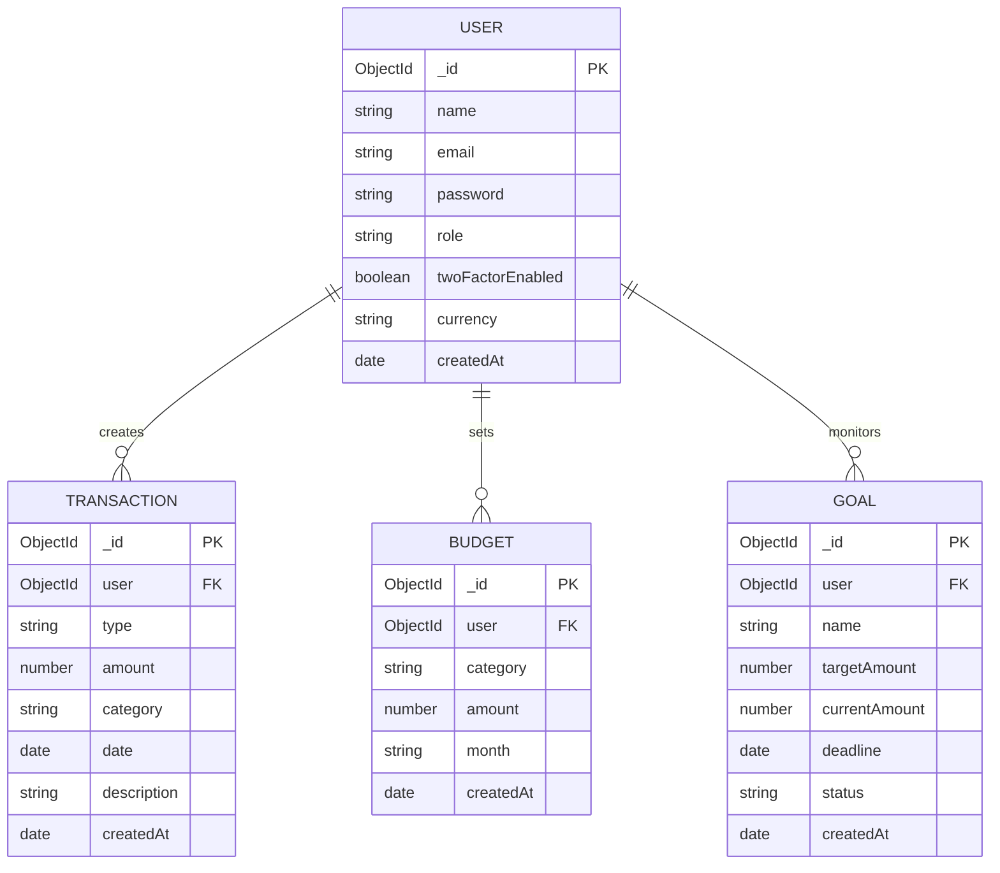
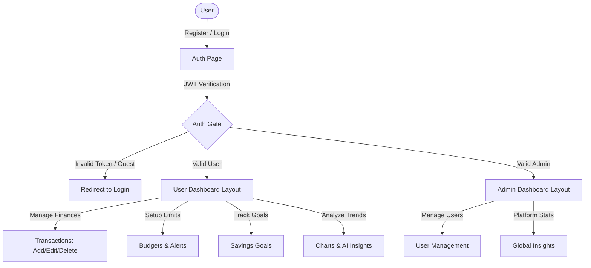

# Smart Finance Manager

Smart Finance Manager is a production-ready, full-stack personal finance ledger and management platform. It features user authentication, dynamic balance calculation, monthly expense category budgeting, savings goals trackers, real-time threshold notifications, and a responsive analytics engine with data visualization, CSV import/export, print-ready PDF reports, and rule-based AI spending forecasts.

The project is built with a Node.js + Express backend, MongoDB database layer, and a React.js (Vite) frontend styled with a modern, Stripe-like design language featuring a responsive sidebar, custom scrollbars, class-based dark mode, and glassmorphism layouts.

---

## Technical Stack

### Backend
- **Node.js & Express.js** (MVC architecture, REST APIs)
- **MongoDB & Mongoose** (Relational-style Document modeling with cascade deletes)
- **JWT & bcryptjs** (Secure authentication, access tokens, password hashing)
- **Security Middlewares**: CORS, Helmet (HTTP headers protection), Rate limiting, Express Validator (Input sanitization)
- **Logging**: Morgan

### Frontend
- **React.js & Vite** (Single Page App, Fast HMR)
- **React Router DOM v6** (Protected route blocks, lazy-loaded page structures)
- **Tailwind CSS v4** (Utility styles, native CSS `@theme` variables, dark-mode toggle)
- **Recharts** (Interactive responsive visual graphs)
- **Axios** (API requests with automatic JWT interceptors and auth failure redirectors)
- **Lucide React** (Vector iconography)

---

## Repository File Structure

```text
/
├── backend/
│   ├── config/              # MongoDB connection configurations
│   ├── controllers/         # Business logic modules (Auth, Transactions, Budgets, Goals, Admin)
│   ├── middlewares/         # Authorization gates, validator validators, error handler stacks
│   ├── models/              # Mongoose schema definitions (User, Transaction, Budget, Goal)
│   ├── routes/              # Express API route registrations
│   ├── seed.js              # Database seeder utility
│   ├── server.js            # Express server entry point
│   ├── test-api.js          # API integration test suite
│   ├── .env.example         # Template for environment variables
│   └── package.json
│
├── frontend/
│   ├── src/
│   │   ├── components/      # Reusable components (ProtectedRoute)
│   │   ├── context/         # AuthContext, ThemeContext
│   │   ├── hooks/           # useAuth, useTheme hooks
│   │   ├── layouts/         # DashboardLayout, AuthLayout
│   │   ├── pages/           # Dashboard, Expenses, Income, Budgets, Goals, Analytics, Settings, Admin, Login, Signup
│   │   ├── services/        # Axios api client instance
│   │   ├── utils/           # Date and currency formatters
│   │   ├── index.css        # Core styles & Tailwind imports
│   │   ├── main.jsx         # App bootstrapping
│   │   └── App.jsx          # Route tree definitions
│   ├── package.json
│   ├── tailwind.config.js
│   ├── vite.config.js
│   └── .env.example
│
├── smart_finance_manager_postman_collection.json  # Importable Postman file
└── README.md                # System instructions & reference documentation
```

---

## Entity-Relationship (ER) Diagram



---

## Application Flow Diagram



---

## Setup Instructions

### Prerequisites
- [Node.js](https://nodejs.org) (v18 or higher recommended)
- [MongoDB](https://www.mongodb.com) (Local instance running on `mongodb://127.0.0.1:27017` or a MongoDB Atlas URI)

### 1. Configure the Backend
1. Open a terminal and navigate to the backend folder:
   ```bash
   cd backend
   ```
2. Install npm packages:
   ```bash
   npm install
   ```
3. Initialize the environment variables:
   ```bash
   cp .env.example .env
   ```
4. Run the database seeder to populate mock users and ledger transaction history:
   ```bash
   node seed.js
   ```
5. Run the integration test suite to verify endpoints:
   ```bash
   node test-api.js
   ```
6. Start the backend development server:
   ```bash
   npm run dev
   ```
   *The server starts listening on port `5005` (configured to avoid conflict with AirPlay port 5000 on macOS).*

### 2. Configure the Frontend
1. Open a new terminal window and navigate to the frontend folder:
   ```bash
   cd frontend
   ```
2. Install dependencies:
   ```bash
   npm install
   ```
3. Copy environment configuration:
   ```bash
   cp .env.example .env
   ```
4. Start the frontend development server:
   ```bash
   npm run dev
   ```
5. Open your browser to `http://localhost:5173`.
6. Log in with one of the seeded user profiles:
   - **Standard Account**: Email: `john@smartfinance.com` | Password: `password123`
   - **Admin Account**: Email: `admin@smartfinance.com` | Password: `password123`

---

## REST API Documentation

### Base URL
`http://127.0.0.1:5005/api`

### Headers
For protected endpoints, include:
`Authorization: Bearer <jwt_access_token>`

### 1. Authentication Endpoints

#### `POST /auth/register` (Public)
Registers a user account.
- **Request Body**:
  ```json
  {
    "name": "Jane Doe",
    "email": "jane@smartfinance.com",
    "password": "password123"
  }
  ```
- **Response (201 Created)**:
  ```json
  {
    "success": true,
    "token": "eyJhbGciOi...",
    "user": {
      "_id": "60c72b2f...",
      "name": "Jane Doe",
      "email": "jane@smartfinance.com",
      "role": "user",
      "currency": "USD",
      "twoFactorEnabled": false
    }
  }
  ```

#### `POST /auth/login` (Public)
Authenticates credentials and returns a JWT access token.
- **Request Body**:
  ```json
  {
    "email": "john@smartfinance.com",
    "password": "password123"
  }
  ```
- **Response (200 OK)**:
  ```json
  {
    "success": true,
    "token": "eyJhbGciOi...",
    "user": { ... }
  }
  ```

#### `POST /auth/forgot-password` (Public)
Simulates generating a password reset token (logged to the server console).
- **Request Body**:
  ```json
  { "email": "john@smartfinance.com" }
  ```
- **Response (200 OK)**:
  ```json
  {
    "success": true,
    "message": "Password reset link simulated in console. Use token: abc...",
    "resetToken": "abc..."
  }
  ```

#### `POST /auth/reset-password` (Public)
Resets password using a simulated recovery token.
- **Request Body**:
  ```json
  {
    "token": "abc...",
    "password": "newpassword123"
  }
  ```
- **Response (200 OK)**:
  ```json
  {
    "success": true,
    "message": "Password reset successful. You can now login."
  }
  ```

---

### 2. Transaction Endpoints

#### `GET /expenses` (Protected)
Retrieves expense records (supports search, sort, category filtering, and pagination).
- **Query Params**:
  - `page` (default 1)
  - `limit` (default 10)
  - `search` (searches description/category)
  - `category` (filters by category)
  - `sortBy` (e.g. `date:desc`, `amount:asc`)
- **Response (200 OK)**:
  ```json
  {
    "success": true,
    "count": 9,
    "pagination": {
      "total": 9,
      "page": 1,
      "pages": 1,
      "limit": 10
    },
    "data": [
      {
        "_id": "6a5b...",
        "user": "60c7...",
        "type": "expense",
        "amount": 120,
        "category": "Food",
        "date": "2026-07-18T10:00:00Z",
        "description": "Weekly grocery list"
      }
    ]
  }
  ```

#### `POST /expenses` (Protected)
Logs a new expense.
- **Request Body**:
  ```json
  {
    "amount": 45.00,
    "category": "Food",
    "date": "2026-07-18",
    "description": "Mid-day business meeting lunch"
  }
  ```
- **Response (210 Created)**:
  ```json
  {
    "success": true,
    "data": { ... }
  }
  ```

*Note: The `/income` sub-endpoints are identical in structure to `/expenses` but log transactions of type `income`.*

---

### 3. Budgets & Goals Endpoints

#### `GET /budgets` (Protected)
Retrieves category spending caps configured for a specific month.
- **Query Params**: `month` (e.g. `2026-07`)
- **Response (200 OK)**:
  ```json
  {
    "success": true,
    "month": "2026-07",
    "data": [
      {
        "_id": "50d...",
        "user": "60c7...",
        "category": "Food",
        "amount": 400,
        "month": "2026-07"
      }
    ]
  }
  ```

#### `POST /budgets` (Protected)
Sets or updates category limit parameters.
- **Request Body**:
  ```json
  {
    "category": "Food",
    "amount": 500.00,
    "month": "2026-07"
  }
  ```

---

## DevOps Dockerization & CI/CD Pipeline Guide

This project includes a fully production-ready DevOps CI/CD pipeline. All services (frontend, backend, database) are containerized using Docker, and the deployment is automated from Docker Hub to Render.

### 1. Architecture & Pipeline Flow

The deployment pipeline is triggered automatically on every git push or pull request to the `main` branch:

```text
Developer (Git Push)
    ↓
GitHub Repository
    ↓
GitHub Actions (Triggered)
    ├─► Install Dependencies (Frontend/Backend)
    ├─► Run Frontend Linting (oxlint)
    ├─► Run Backend Unit Tests (Jest)
    └─► Run Backend Integration Tests (Database-dependent)
    ↓ (Passes)
Build Docker Images
    ├─► Backend: node:20-alpine
    └─► Frontend: nginx:alpine serving React + reverse proxy
    ↓ (Pushed to Registry)
Docker Hub (Hosted Image Repository)
    ↓ (CD Triggered)
Render Deployment (Pulls latest images & starts containers)
```

---

### 2. Docker Setup & Configurations

#### A. Backend Dockerfile
The backend uses a multi-stage Docker build (`backend/Dockerfile`) based on `node:20-alpine`:
- Installs only production dependencies to maintain a lightweight image.
- Implements a Docker healthcheck using the container's built-in `wget` command to query `/health`.

#### B. Frontend Dockerfile & Nginx Proxy
The frontend uses a multi-stage Docker build (`frontend/Dockerfile`):
- **Build Stage**: Compiles React JS files with Vite (injecting `VITE_API_URL=/api` so requests are relative).
- **Run Stage**: Serves the build artifacts using `nginx:alpine`.
- **Nginx Config (`frontend/nginx.conf.template`)**: Acts as a reverse proxy. It listens on port 80, serves static files, and routes `/api` and `/health` requests directly to `${BACKEND_URL}`.
- Nginx resolves `${BACKEND_URL}` at startup via environment variable substitution.

#### C. Local Multi-Container Orchestration (Docker Compose)
A `docker-compose.yml` is provided in the project root to start the entire stack:
- **mongodb**: Official MongoDB image with persistent volume mapping.
- **backend**: Express server running on port `5005` inside the docker network.
- **frontend**: Nginx server exposing port `8080` (mapping to Nginx port 80).

**To start the local stack:**
```bash
# Start all containers in background
docker compose up -d

# Check status of running containers
docker compose ps

# View service logs
docker compose logs -f

# Shut down the stack and remove networks
docker compose down -v
```

---

### 3. CI/CD GitHub Actions Configuration (`.github/workflows/ci-cd.yml`)

The pipeline runs in three sequential jobs:

1. **`test` (CI)**: Checks out the repo, sets up Node.js v20, runs a MongoDB service container, installs dependencies, executes Jest unit tests, and runs integration tests. It also runs frontend linting using `oxlint`.
2. **`build-and-push` (CI)**: Runs after tests succeed. Authenticates with Docker Hub using repository secrets, builds backend and frontend images, tags them with the commit SHA and `latest`, and pushes them to Docker Hub.
3. **`deploy` (CD)**: Runs only on direct pushes to `main`. Calls Render's Deploy Hook URLs. Render then pulls the updated image from Docker Hub and initiates a rolling deployment.

---

### 4. Render Deployment & Secrets Configuration

To deploy the application via Docker Hub to Render:

#### Step 1: Add GitHub Secrets
Navigate to your repository **Settings > Secrets and variables > Actions** and add:
- `DOCKER_USERNAME`: Your Docker Hub username.
- `DOCKER_PASSWORD`: Your Docker Hub Personal Access Token (PAT).
- `RENDER_BACKEND_DEPLOY_HOOK`: The backend redeployment URL provided by Render.
- `RENDER_FRONTEND_DEPLOY_HOOK`: The frontend redeployment URL provided by Render.

#### Step 2: Set up Backend on Render
1. Create a **New > Web Service** on Render.
2. Select **Deploy an existing image from a registry**.
3. Input the backend image tag: `docker.io/<your-username>/smart-finance-backend:latest`
4. Set the environment variables in the Render dashboard:
   - `PORT`: `5005`
   - `NODE_ENV`: `production`
   - `JWT_SECRET`: A secure random string.
   - `MONGO_URI`: Your MongoDB database connection string (e.g. MongoDB Atlas or Render's Managed Redis/MongoDB).
5. Under **Settings**, copy the **Deploy Hook** URL and save it as your GitHub secret `RENDER_BACKEND_DEPLOY_HOOK`.

#### Step 3: Set up Frontend on Render
1. Create another **New > Web Service** on Render.
2. Select **Deploy an existing image from a registry**.
3. Input the frontend image tag: `docker.io/<your-username>/smart-finance-frontend:latest`
4. Set the environment variables in the Render dashboard:
   - `BACKEND_URL`: The public URL of your backend Render service (e.g. `https://smart-finance-backend.onrender.com`).
5. Under **Settings**, copy the **Deploy Hook** URL and save it as your GitHub secret `RENDER_FRONTEND_DEPLOY_HOOK`.

